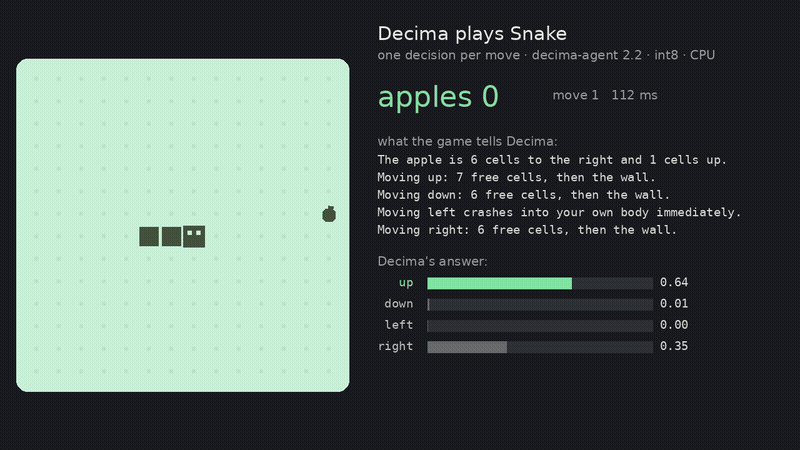

# Decima-agent

**A 321M local judge for agents and knowledge graphs. It decides in milliseconds on a CPU, and nothing leaves your machine.**

Give it a situation, a question and your options; it returns calibrated probabilities. It speaks TypeSafe's
`/v1/systemone` format, so code written for Jev works after a one-line change. It is the judge, not the writer: it sits
next to your agent or your extraction pipeline and decides what is safe, what is true, and when the expensive model is
needed.

- **Agent gates:** secret in this edit? Should this command run, ask or be denied? Which tool, which exact command, what next?
- **Knowledge-graph judgments:** is this extracted fact asserted, hypothetical, denied or planned? Are these two records
  the same entity? Are these two things alternatives? Which relation holds?
- **Long documents:** 2.3 reads up to 8,192 tokens (2.2: 2,048), so a whole contract or report fits in one state.


**[Try it in your browser](https://huggingface.co/spaces/amyrmahdy/decima-playground)**, with every preset. Nothing is uploaded; the model runs on your device.

## Quickstart

```bash
pip install decima-ai          # the `decima` package, CLI and server (PyPI; source: github.com/amyrmahdy/decima)
```

```python
from decima import Decima, Question

m = Decima.from_pretrained("amyrmahdy/decima-agent")          # int8 ONNX, CPU
q = Question("Should the agent's proposed command run?",
             ["allow: read-only, builds or tests", "ask: changes something recoverable", "deny: destroys data or history"])
print(m.decide('{"tool": "Bash", "command": "rm -rf .loop/ data/"}', q).top)   # → deny: destroys data or history
```

From the command line, with ready-made presets:

```bash
decima "rm -rf ~/projects/app" --preset agent-gate          # gate: deny 0.98
decima "Acme denied it had acquired Beta Labs." --preset kg-judge   # status: negated 0.99
```

As a local server for any TypeSafe client (binds to 127.0.0.1):

```bash
python -m decima.serve --model amyrmahdy/decima-agent --port 11436
```

For Claude Code, copy the hooks in [`integrations/claude-code`](https://github.com/amyrmahdy/decima/tree/main/integrations/claude-code):
rules first, then Decima, fail closed, shadow mode to start.

## Results

Measured on data the model never trained on.

**Agent decisions: 40 cases written after training, with no exact or near copy in any training data**

| | decima-base | agent 2.0 | agent 2.1 | agent 2.2 | **agent 2.3** |
|---|---:|---:|---:|---:|---:|
| Read-only or not (12) | 7 | 10 | 9 | 9 | **9** |
| Bash gate: allow / ask / deny (18) | 11 | 15 | 15 | 16 | **17** |
| Secret gate (10) | 6 | 8 | 9 | 9 | **10** |
| **All 40** | 0.60 | 0.83 | 0.83 | 0.85 | **0.90** |

On the shipped int8 runtime 2.3 gets 35 of 40 (one read-only case flips); 2.2 got 34 on both.

**Knowledge-graph judgments: William Lyon's public notebooks** (measured on 2.2; the 2.3 re-run is in progress and will
be added here)
([extraction-knowledge-graph-experiments](https://github.com/johnymontana/extraction-knowledge-graph-experiments)): the
same pipeline and questions, with Jev swapped for a local Decima. None of the notebooks' documents or Beer pairs were in
training.

| | Jev (published) | decima-agent 2.1 | **decima-agent 2.2** |
|---|---:|---:|---:|
| Planted "maybe / denied / planned" traps caught | 8/11 | every answer 0.5 | **11/11** |
| Beer entity matching, AUC (450 pairs) | 0.992 | 0.228 | **0.972** |
| Assertion gate over GLiNER edges, F1 (ungated 0.330) | 0.404 | 0.294 | **0.368** |
| GLiNER ∪ relation selection, both gated, F1 | 0.343 | — | **0.364** |
| Alternatives vs not, separated by one threshold | yes | — | **yes** |
| Support threads: intent / priority / resolved (8 each) | 5 / 3 / 8 | — | **7 / 3 / 3** |

Jev is better at deciding whether a support thread is resolved and at filtering wrong facts. decima-agent is better at
catching hedged facts and at relation selection, and it runs on your CPU for free.

**Games** (text sensors, one decision per move, the games' own wording never in training): 2.3 plays Snake worse than
2.2, at 26.6 apples a game with none of 10 games alive at the 600-move limit (2.2: 42 apples, 6 alive). The long-document
training cost some of that skill. Platformer: 9 of 10 levels, the same as 2.2. If you want the Snake player, pin
`revision="v2.2"`.



**Speed:** about 50 ms per decision on one CPU thread and 20 ms on four (an ARM CPU) for a short state
with its options cached. Long states cost more: on four busy CPU threads we measured about 0.5 s at 500 words, 5 s at
2,000 words and 10 s at 4,000 words. For long documents, a GPU or the read-once batching in `decide_many` helps.

## What changed in 2.3

- **8,192-token states.** The question stays inside the document reading, as in 2.2. We tried a "read-once" design that
  encodes the document without the question. It cost 12 points on claim-specific knowledge-graph judgments
  (0.959 → 0.835), so it was dropped.
- Trained on long-context rows whose deciding sentence is buried 2k–8k tokens deep, plus the knowledge-graph document
  data at full weight.
- **Fresh agent test:** 0.85 → 0.90. Knowledge-graph test sets: 0.959 → 0.961. Other agent sets are within a point.
- decima-ai 2.3.0 fixes a choice-window shortcut that could tie both options at 0.5 for short questions in rare scripts
  or with emoji (thanks to Ollaya for the report).

## What changed in 2.2

- Knowledge-graph judgments: record and mention matching, fact modality, "does the document discuss this?", relation
  selection with direction and `none`, typing a mention by what it refers to, alternatives vs complementary, long
  support threads (about 190k rows; labels exact from code or agreed by two models).
- Agent gates trained on what field logs showed: real-shape shell commands, credentials passed inline (client calls,
  Bearer headers, curl), more key formats, destructive cloud and cluster commands, database commands.
- Snake states where the apple's direction is a closed pocket smaller than the body.
- Options are always kept whole in the choice window, so long questions no longer tie at 0.5.

## Limitations

- **Never the only line of defence.** Keep hard rules first (the hooks do), plus your sandbox and secret scanning in CI.
  In the fresh test it still calls one unseen key format (Mailgun `key-…`) "not a secret", and sends two destructive
  commands to "ask" instead of "deny".
- **States up to 8,192 tokens.** Longer input is refused, never silently cut. Split longer documents first.
- **Many questions about one long document are slow:** each question re-reads the document (seconds per question at
  thousands of words on CPU).
- **General classification dropped a little in 2.3:** Kev's protocol 0.753 → 0.737, JevBench 0.606 → 0.584. Typed
  decisions went up (0.459 → 0.489). For general routing and triage, decima-base is the better pick.
- **English agent data only.** The backbone is multilingual; the agent and knowledge-graph skills were trained in English.
- **Small test sets.** 40 fresh agent cases and 8 support threads mean wide error bars.
- **A correction:** an earlier card reported gains on a 130-case hand-written set that turned out to have near-copies in
  the training data. The 40-case fresh set replaces it, and every training mix now drops rows that copy a test case
  ([`teacher/decontam_agent.py`](https://github.com/amyrmahdy/decima/blob/main/teacher/decontam_agent.py)).

## Training

decima-base (mmBERT-base, 321M) → agent 2.0 → 2.1 → knowledge-graph rounds → 2.2 → 2.3 (8k-token states). Each round
replays general data so the general skills mostly stay (mean of Kev, Laya, Decima bench, JevBench and typed decisions in
our harness: 2.2 0.668, 2.3 0.664). The training data is public:
[decima-agent-decisions](https://huggingface.co/datasets/amyrmahdy/decima-agent-decisions),
[decima-kg-judgments](https://huggingface.co/datasets/amyrmahdy/decima-kg-judgments),
[decima-game-decisions](https://huggingface.co/datasets/amyrmahdy/decima-game-decisions) and
[decima-system-one-tasks](https://huggingface.co/datasets/amyrmahdy/decima-system-one-tasks).

## License and citation

Apache-2.0. Built by **A. M. Madani** ([@amyrmahdy](https://github.com/amyrmahdy)).

```bibtex
@software{madani2026decima,
  author = {Madani, Amir Mahdi},
  title  = {Decima: open, calibrated decision models},
  year   = {2026},
  url    = {https://github.com/amyrmahdy/decima}
}
```
